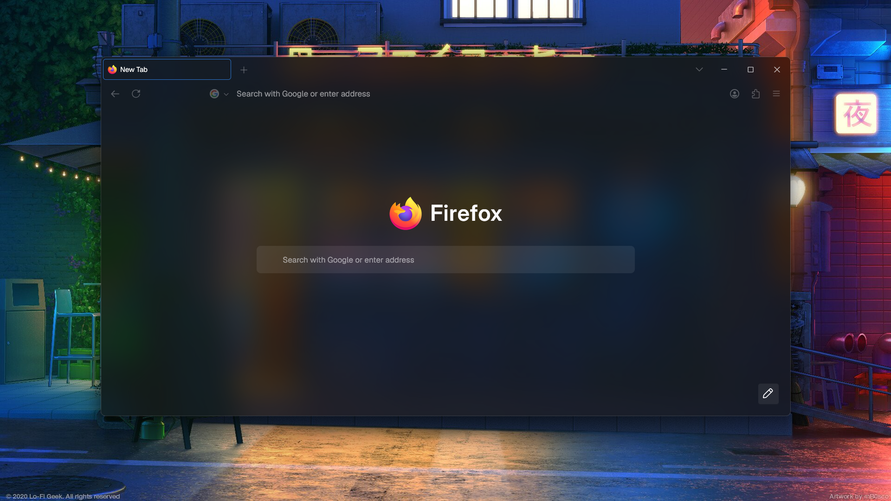
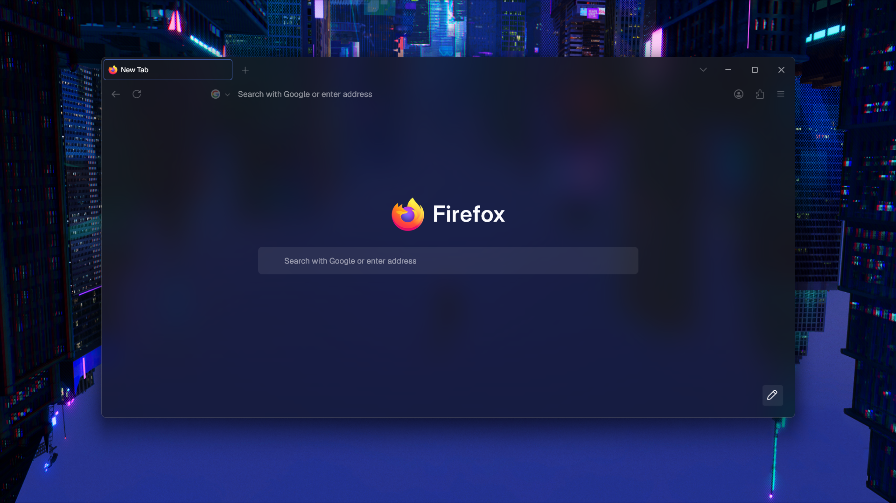
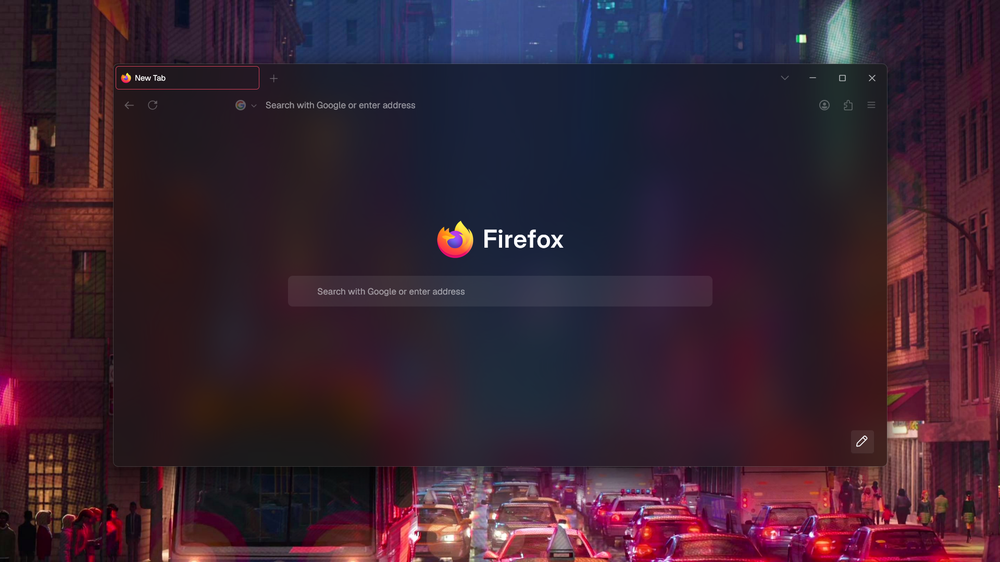
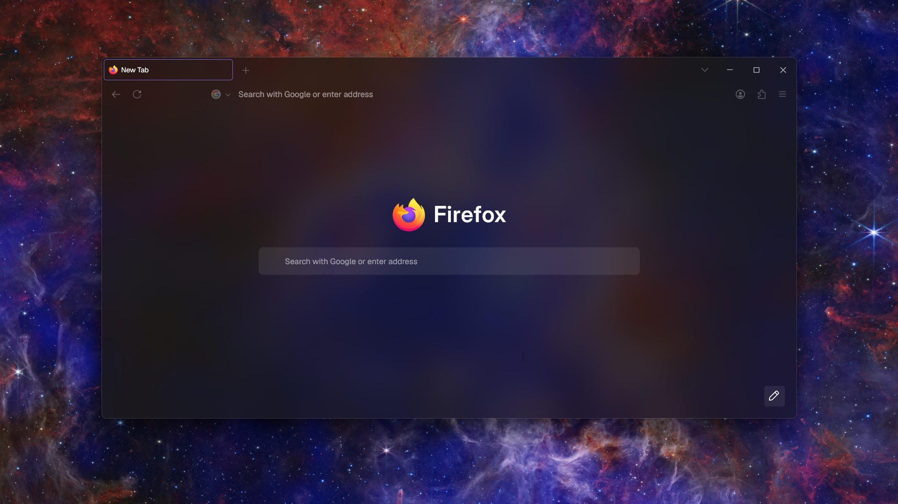
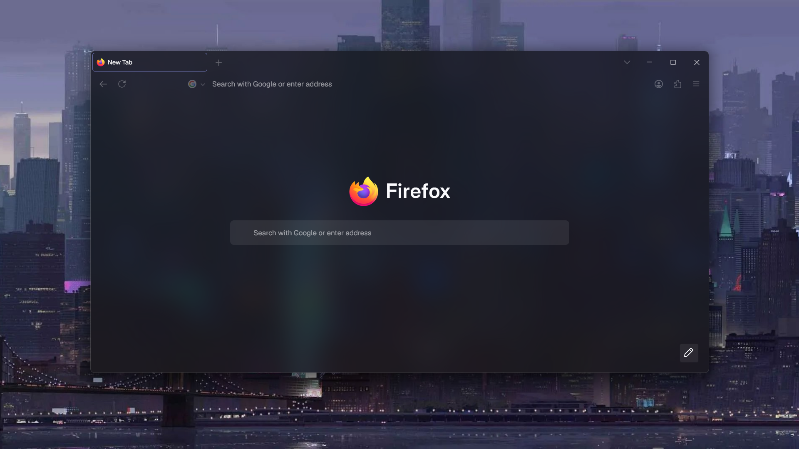
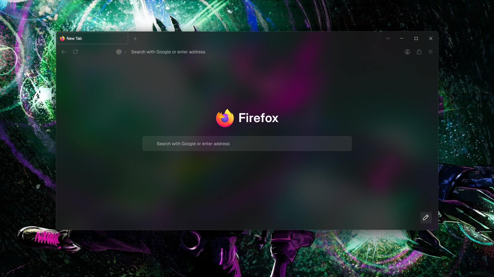

# Calm Accent ☁️
  
Calm Accent is a custom Firefox theme for Windows that leverages your system's accent color to create translucent UI surfaces for a sleek, modern aesthetic.

This is a fork of [Latin Accent](https://github.com/Acercandr0/Latin-Accent), modified to enhance the visual experience with a native Firefox look and feel, while maintaining the original's calm aesthetic and updating it for modern Firefox versions.

## Preview



**CSS animations**
|  |  |
|:--:|:--:|

**Works with your accent**
<table style="width:100%;">
  <tr>
    <td style="width:20%; text-align:center;"></td>
    <td style="width:20%; text-align:center;"></td>
    <td style="width:20%; text-align:center;"></td>
    <td style="width:20%; text-align:center;"></td>
    <td style="width:20%; text-align:center;"></td>
  </tr>
</table>

## 🛠 Installation

1.  Open **`about:profiles`** in Firefox.
2.  Find the **Root Directory** of your active profile and open it.
3.  Navigate to the **`chrome`** folder. If the folder doesn't exist, create it.
4.  Copy the **`userChrome.css`** and **`userContent.css`** files from this repository into the `chrome` folder.

Your `chrome` folder should now contain the following files:

* `userChrome.css`
* `userContent.css`

### ⚙️ Enable Custom CSS in Firefox
Go to `about:config` and set the following preference to **true**:

```
toolkit.legacyUserProfileCustomizations.stylesheets
```

This allows Firefox to load your custom `userChrome.css` and `userContent.css`.

### 🚩 Necessary flags
In `about:config`, set the following preferences to **true** ✅:

```
browser.tabs.allow_transparent_browser
widget.transparent-windows
widget.windows.mica
gfx.webrender.all
```

In `about:config`, set the following preferences to **false** ❌:

```
browser.nova.enabled
browser.newtabpage.activity-stream.nova.enabled
```

### 🪟 Transparency - Option 1
In `about:config`, set to **2**
```
widget.windows.mica.toplevel-backdrop
```

### 🪟 Transparency - Option 2
Use [**Mica For Everyone**](https://github.com/MicaForEveryone/MicaForEveryone)

### 🪟 Transparency - Option 3
Use [**Translucent Windows (Windhawk mod)**](https://windhawk.net/mods/translucent-windows)

## 🧪 Optional - Custom Font and Transparent Zen
To match the full vibe, install the [**Geist**](https://fonts.google.com/specimen/Geist) font and set it as your default font in Firefox settings.
For a more immersive experience, you can also install the [**Transparent Zen**](https://addons.mozilla.org/de/firefox/addon/transparent-zen) extension to make all (supported) pages transparent.

### Steps:
1. Install the [**Geist**](https://fonts.google.com/specimen/Geist) font from Google Fonts on your system.
2. Open Firefox settings and go to the **Accessibility** section.
3. Under **Fonts**, select **Geist** as your default font.
4. Install the [**Transparent Zen**](https://addons.mozilla.org/de/firefox/addon/transparent-zen) extension.
5. Restart Firefox.
6. Your new tab page will now match the Calm Accent theme's aesthetic.

### 💬 Notes
- Restart Firefox after installing or editing any styles.
- Some effects depend on OS-level features (e.g. Mica on Windows 11)
- Transparency effects may vary depending on your system theme and hardware acceleration settings.
- As of now, only works as expected with dark mode enabled in Firefox.

## 🐢 Fork by [@ItsCR24](https://github.com/ItsCR24)
## 🧉 Original made by [@Acercandr0](https://github.com/Acercandr0)
Enjoy!